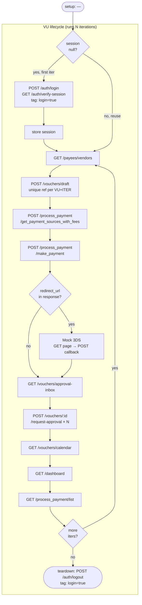
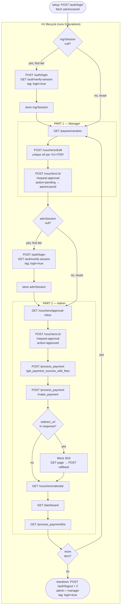

# k6 Load Tests

## Setup

Fill in `k6/config.js` before running:

```js
export const BASE_URL = 'https://staging-api.xcentro.in';
export const ADMIN   = { email: '...', password: '...' };
export const MANAGER = { email: '...', password: '...' };
```

## Scripts

### `admin_journey.js`

Single-user full flow as admin/owner. Login happens once per VU and is reused across all iterations.



> Owner role pays directly — no separate approval step needed on own vouchers.

---

### `manager_journey.js`

Cross-user flow: manager creates a voucher and requests approval, admin approves and pays it. Both sessions are logged in once per VU.



> Login count: `--vus 10` → 10 manager + 10 admin logins total (vs ~1200 per-iteration logins before).

---

## Utils

| File | Purpose |
|------|---------|
| `utils/auth.js` | Cookie-based login. Extracts `csrf_token` from `Set-Cookie` header (Domain scoping prevents reading from jar). Returns `{ jar, userId, bid, csrfToken }`. |
| `utils/mock3ds.js` | Completes mock 3DS: extracts params from redirect URL via regex, GETs the page, POSTs form callback to `/v1/process_payment/callback?type=mockpg`. |
| `utils/timing.js` | Per-step timer. `t.track('name', () => fn())` wraps each call. `t.summary(__VU, __ITER)` prints slowest, fastest, and full ranked list at end of iteration. |

---

## Thresholds

Both scripts enforce:
- `http_req_failed < 20%`
- `http_req_duration p(95) < 8000ms`

---

## Important: `--iterations` vs `--duration`

- `--iterations 1` — runs the full workflow exactly once and stops. Use for smoke testing.
- `--duration 5m` — keeps looping for 5 minutes. Use for load testing.

Never use `--duration` for debugging — failures will hammer the same call in a loop.

---

## Commands

```bash
# Smoke test — run once, verify 0 errors
k6 run --vus 1 --iterations 1 k6/admin_journey.js
k6 run --vus 1 --iterations 1 k6/manager_journey.js

# Load test
k6 run --vus 10 --duration 5m k6/admin_journey.js
k6 run --vus 10 --duration 5m k6/manager_journey.js

# Stress test
k6 run --vus 50 --duration 5m k6/admin_journey.js
k6 run --vus 50 --duration 5m k6/manager_journey.js

# Override base URL at runtime
k6 run --vus 10 --duration 5m --env BASE_URL=https://other.xcentro.in k6/admin_journey.js
```

---

## Timing Output

At the end of each iteration you'll see:

```
[VU 1 ITER 0] SLOWEST: make_payment 843ms | FASTEST: get_sources 312ms
[VU 1 ITER 0] All steps ranked:
  1. make_payment: 843ms
  2. get_sources: 312ms
  3. create_voucher: 201ms
  ...
```

Login is omitted from per-iteration timing after the first iteration (session is reused). Logout only appears in `teardown()`.

---

## Recommended Flow

1. Fill `config.js`
2. Smoke test each script (`--vus 1 --iterations 1`)
3. Confirm 0 errors and timing output looks sane
4. Scale to `--vus 10 --duration 5m`
5. Run both scripts in parallel (two terminals)
6. Scale to `--vus 50+` to stress test
